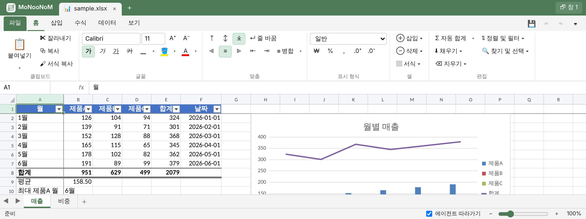
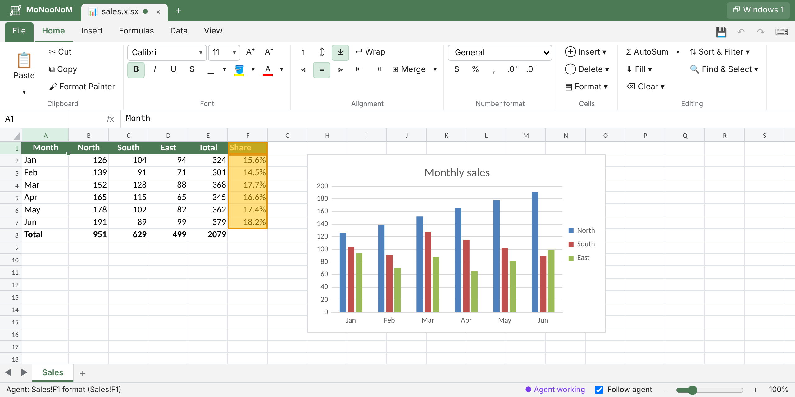

# MoNooNoM

[English](README.md) | **한국어**


사람과 AI 에이전트가 **같은 스프레드시트를 함께 보면서 작업하는** 로컬 웹 스프레드시트입니다.
에이전트가 Excel 파일(xlsx·xlsm, xls 읽기)을 열고 고치면, 사용자는 에이전트 앱의 미리보기 창(또는 브라우저)에서
그 변화를 실시간으로 보고 직접 편집할 수 있습니다. 이름은 '모눈(종이)'을 영어로 쓰고 어느 쪽에서도 읽히게 만든 것입니다(MoNooN + NooNoM).



- **함께 편집**: 에이전트의 변경과 사용자의 변경이 서버에서 순서대로 합쳐져 모든 창에 바로 반영됩니다. 에이전트는 사용자가 바꾼 셀을 `changes`로 읽습니다.
- **Excel 호환**: 수식 약 200개 함수, 서식, 필터·정렬, 차트(막대·꺾은선·원형·분산형·콤보 등), 피벗 테이블, Excel 단축키. 저장하면 원본의 조건부 서식·이미지·VBA 등은 그대로 보존됩니다.
- **로컬 전용**: Python 서버가 `127.0.0.1`에서만 동작하고, 파일은 작업 폴더 밖으로 나가지 않습니다. 파일 읽기·쓰기는 Python 함수 한 곳을 지나므로 DRM 훅을 붙일 수 있습니다.


*에이전트가 차트를 추가한 뒤 Share(비율) 열을 채우는 중입니다. 바뀐 셀이 강조되고 상태 표시줄에 에이전트가 한 일이 표시됩니다.*

## 설치

필요한 것: **Python 3.9+**, `openpyxl`(필수), `xlrd`(.xls를 열 때만). Node.js 18+가 있으면 미리보기를 열지 않았을 때도 수식을 계산합니다.

```bash
python3 -m pip install openpyxl xlrd
```

에이전트와 **같은 컴퓨터**에서 실행되어야 합니다(미리보기가 `localhost`에 접속). 클라우드에서 도는 에이전트 세션이나 Skills API에서는 쓸 수 없습니다.

### Claude Code: 플러그인으로 설치 (권장)

```bash
claude plugin marketplace add JISUlicious/monoonom
claude plugin install monoonom@monoonom
```

세션 안에서는 `/plugin install monoonom --marketplace JISUlicious/monoonom`(Claude Code 2.1.275 이상)로 한 번에 설치할 수 있습니다.
업데이트는 `claude plugin update monoonom@monoonom`. skill 이름은 `/monoonom:monoonom`입니다.

### 다른 에이전트 (Codex, Cursor, Copilot 등): `npx skills`

```bash
npx skills add JISUlicious/monoonom            # 현재 프로젝트에 (에이전트 선택)
npx skills add JISUlicious/monoonom -g -a codex # 모든 프로젝트, 특정 에이전트
```

[skills CLI](https://github.com/vercel-labs/skills)가 `.agents/skills/monoonom/`(이식판 `SKILL.md`)를 설치합니다. Claude Code에 이 방법으로 설치해도 동작하지만, 플러그인판에 있는 명령 자동 허용(`allowed-tools`)·서버 상태 표시·데스크톱 미리보기 안내는 빠집니다.

### 직접 복사

`.agents/skills/monoonom/` 폴더를 에이전트의 skill 폴더(예: `~/.agents/skills/`, Claude Code는 `~/.claude/skills/`)에 복사합니다. Claude Code에 복사할 때는 `SKILL.claude-code.md`를 `SKILL.md`로 바꿔 넣습니다.

## 사용

에이전트에게 평소처럼 요청하면 됩니다. 예:

- "report.xlsx 열어서 같이 보자"
- "매출 시트에 월별 합계 열 추가하고 꺾은선 차트 만들어 줘"
- "내가 방금 고친 셀 확인해서 나머지 행도 같은 식으로 맞춰 줘"

에이전트가 서버를 띄우고 미리보기 주소(`http://127.0.0.1:8765/#t=토큰`)를 알려 줍니다. Claude Code 데스크톱에서는 미리보기 창에 바로 열리고,
VS Code·Cursor에서는 Simple Browser, 그 밖에는 일반 브라우저로 엽니다.
화면은 영어로 표시되고 브라우저 언어가 한국어이면 한국어로 표시됩니다. 주소에 `?lang=ko` 또는 `?lang=en`을 붙여 고를 수 있습니다(브라우저에 기억됨). 저장하면 이전 파일은 `<작업 폴더>/.monoonom/backups/`에 남습니다.

에이전트가 쓰는 명령(직접 실행해도 됩니다):

```bash
XL=<skill 폴더>/scripts/xl.py          # 작업 폴더에서 실행
python3 $XL serve                       # 서버 시작(이미 있으면 재사용) → 미리보기 주소
python3 $XL open report.xlsx            # 열기 → 미리보기에 탭으로 표시
python3 $XL describe                    # 시트·사용 범위·머리글·차트
python3 $XL fill 'G2:G7' '=E2*0.3'      # 수식 채우기
python3 $XL chart add A1:D7 --type line --title 추이 --at H20
python3 $XL changes --since 0 --actor user   # 사용자가 미리보기에서 바꾼 것
python3 $XL save                        # 저장
python3 $XL stop
```

전체 명령: [`references/cli.md`](.agents/skills/monoonom/references/cli.md) · 일괄 편집 형식: [`references/edits.md`](.agents/skills/monoonom/references/edits.md) · 문제 해결: [`references/troubleshooting.md`](.agents/skills/monoonom/references/troubleshooting.md) · UI 기능 ↔ 명령 대응: [`docs/agent-coverage.md`](docs/agent-coverage.md)

### 보안

서버는 `127.0.0.1`에만 바인딩하고 Host 헤더를 검사합니다(DNS 리바인딩 방지). 모든 API는 작업 폴더별 토큰이 필요하며, 작업 폴더 밖의 파일은 열 수 없습니다(`--no-sandbox`로 해제).
상태 파일(`server.json`, 토큰, 로그)은 `<작업 폴더>/.monoonom/`에 있습니다.

### DRM 환경

브라우저는 파일 내용에 접근하지 않고 경로만 보냅니다. 모든 디스크 I/O는 `scripts/server/fileio.py`를 지나며,
`MONOONOM_READ_HOOK=pkg.mod:func`, `MONOONOM_WRITE_HOOK=...`로 DRM SDK 함수를 끼울 수 있습니다.

## 단축키

`Ctrl+N/O/S`, `F12`, `Ctrl+Z/Y`, `Ctrl+C/X/V`, `Ctrl+Alt+V`, `Ctrl+B/I/U/5`, `Ctrl+1`, `F2`, `F4`, `Alt+Enter`, `Ctrl+Enter`, `Ctrl+D/R`, `Ctrl+;`, `Alt+=`, `Ctrl+Shift+L`, `Alt+↓`, `Ctrl+F/H`, `Ctrl+방향키`, `Ctrl+Shift+방향키`, `Ctrl+Home/End`, `Ctrl+Space`, `Shift+Space`, `Ctrl++/-`, `Ctrl+PgUp/PgDn`, `Shift+F11`, `Alt+F1`, `Shift+F2`, `Ctrl+K`, `F9` 등 (앱의 `⌨` 버튼에 전체 목록).
일반 브라우저 탭에서는 `Ctrl+N/W/Tab` 등을 브라우저가 먼저 가로챌 수 있습니다(대체: `Alt+N`, 탭 클릭).

## 알려진 제한

- **xls는 읽기 전용**: 계산된 값만 읽습니다(xlrd가 수식 텍스트를 주지 않음). 저장하면 같은 이름의 .xlsx를 만들고 원본 .xls는 그대로 둡니다.
- 조건부 서식·이미지·스파크라인은 **표시하지 않지만 저장 시 보존**됩니다. 행을 삽입해도 이들의 범위는 이동하지 않습니다.
- 피벗 테이블: 보존·영역 표시·새로 고침·새로 만들기(표 형식)를 지원합니다. 피벗 안의 편집과 피벗을 가로지르는 삽입·삭제·정렬은 거부됩니다.
- 동적 배열 수식은 결과를 분산(spill)하지 않고 왼쪽 위 값만 표시합니다.
- 차트 세부 서식(개별 색, 데이터 레이블, 보조 축)은 수정하면 기본 스타일로 다시 만들어집니다.
- 셀 단위 "셀 밀기" 삽입·삭제는 다른 수식의 참조를 조정하지 않습니다(행·열 전체 삽입·삭제는 조정).

## 개발

저장소 구조, 설계 결정과 근거, 테스트 실행 방법, 배포 구성은 [docs/development.md](docs/development.md)에 있습니다. 작업 기록: [logs.md](logs.md), 문서 색인: [index.md](index.md).

```bash
python3 run.py --port 8765 --root .      # 개발용 포그라운드 실행
python3 tests/skill_package.test.py      # skill·플러그인 패키지 검사
claude plugin validate --strict .        # 플러그인·마켓플레이스 검증
```

## 라이선스

MIT ([LICENSE](LICENSE)). 함께 넣은 외부 코드는 Chart.js(MIT, `assets/web/vendor/`) 하나이며 고지는
[`THIRD_PARTY_NOTICES.md`](.agents/skills/monoonom/THIRD_PARTY_NOTICES.md)에 있습니다. Python 패키지(openpyxl, xlrd)는 사용자가 PyPI에서 설치합니다.

## 상표

Microsoft, Excel은 미국 및 기타 국가에서 Microsoft Corporation의 상표입니다. MoNooNoM은 Microsoft와 관련이 없으며 Microsoft가 후원하거나 보증하지 않습니다. 이 문서에서 'Excel'은 파일 형식과 호환되는 동작을 설명하는 데에만 씁니다.
