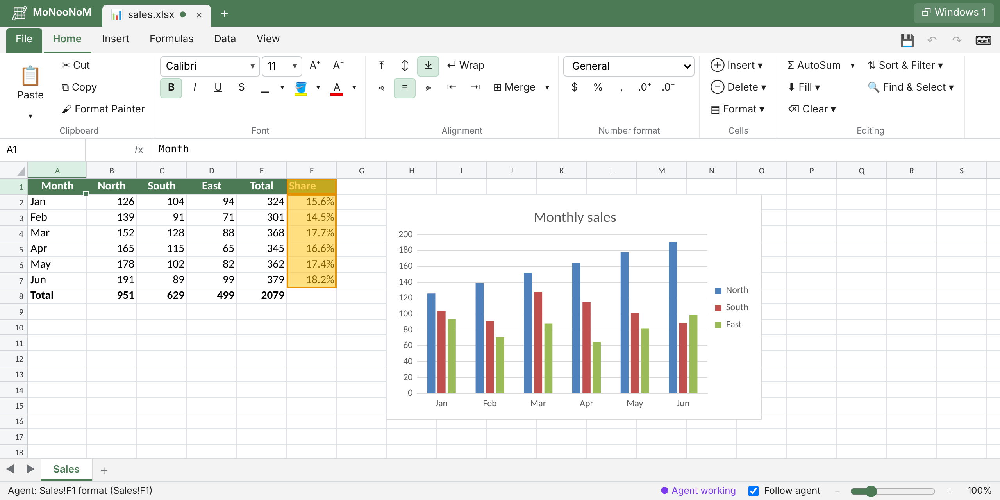

# MoNooNoM

**English** | [한국어](README.ko.md)


A local web spreadsheet where **you and an AI agent work on the same workbook while both of you watch it**.
The agent opens and edits Excel files (xlsx and xlsm; xls read-only), and you see every change live in the agent app's
preview pane (or any browser) and can edit the same workbook yourself. The name is *monoon* (모눈, Korean for graph
paper) written in English so that it reads from either end: MoNooN + NooNoM.


*The agent has just added the chart and is filling the Share column: the cells it changes are highlighted, and the status bar says what it did.*

- **Edit together**: the agent's and your edits are merged in order and appear in every open window. The agent reads the cells you changed.
- **Excel-compatible**: about 200 formula functions, formatting, filters and sorting, charts, pivot tables, Excel keyboard shortcuts. Saving keeps what the app does not edit, such as conditional formatting, images and VBA.
- **Local only**: the server listens on `127.0.0.1`, files never leave the workspace folder, and a DRM hook can be plugged into file reads and writes.

## Quick start

Needs Python 3.9+ on the same computer as the agent: `python3 -m pip install openpyxl xlrd`.

```bash
# Claude Code
claude plugin marketplace add JISUlicious/monoonom
claude plugin install monoonom@monoonom

# Codex, Cursor, Copilot and other agents
npx skills add JISUlicious/monoonom
```

Then ask the agent, for example: "Open report.xlsx so we can look at it together", or "Add a monthly total column
and make a line chart". It gives you the preview URL to open.

## Documentation

| | |
|---|---|
| [Install](docs/guide/install.md) | Requirements, the plugin, `npx skills`, copying by hand, updating and removing |
| [Use](docs/guide/usage.md) | The preview, following the agent, language (`?lang=`), commands, keyboard shortcuts |
| [Security and DRM](docs/guide/security.md) | Token, local-only server, workspace sandbox, DRM hooks |
| [Known limitations](docs/guide/limitations.md) | What is kept but not shown, xls, pivots, charts |
| [Command reference](.agents/skills/monoonom/references/cli.md) | Every `xl.py` command (what the agent reads) |
| [Development](docs/dev/development.md) | Repository layout, design notes, tests (Korean) |

## License

MIT ([LICENSE](LICENSE)). The only bundled third-party code is Chart.js (MIT); see
[`THIRD_PARTY_NOTICES.md`](.agents/skills/monoonom/THIRD_PARTY_NOTICES.md).

## Trademarks

Microsoft and Excel are trademarks of Microsoft Corporation in the United States and other countries. MoNooNoM is not affiliated with, sponsored by or endorsed by Microsoft. "Excel" is used here only to describe compatibility with its file formats and behavior.
