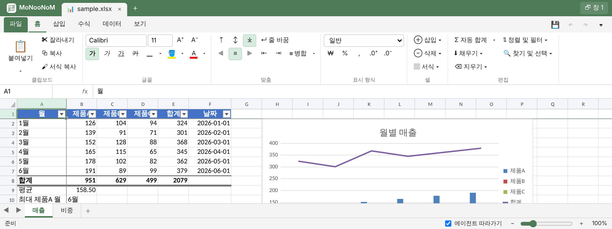

# 사용

[English](usage.md) | **한국어** · [README로](../../README.ko.md)

## 에이전트와 함께 작업하기



에이전트에게 평소처럼 요청하면 됩니다: "report.xlsx 열어서 같이 보자", "월별 합계 열 추가하고 꺾은선 차트 만들어 줘",
"내가 방금 고친 셀 확인해서 나머지 행도 같은 식으로 맞춰 줘".

- 에이전트가 서버를 띄우고 미리보기 주소(`http://127.0.0.1:8765/#t=토큰`)를 알려 줍니다. 받은 그대로 여세요. `#t=` 토큰이 열쇠입니다.
- Claude Code 데스크톱은 미리보기 창에 바로 열고, VS Code·Cursor에서는 Simple Browser, 그 밖에는 일반 브라우저로 엽니다.
- 에이전트와 사용자의 편집이 순서대로 합쳐져 열린 모든 창에 반영됩니다. 에이전트가 바꾼 셀은 강조되고 상태 표시줄에 무엇을 했는지 나옵니다.
- **에이전트 따라가기**(상태 표시줄): 켜면 화면이 에이전트가 작업하는 곳으로 이동하고, 끄면 화면은 그대로 두고 바뀐 셀만 강조합니다.
- 저장하면 이전 파일은 `<작업 폴더>/.monoonom/backups/`에 남습니다. 연 뒤에 다른 프로그램이 바꾼 파일은 묻지 않고 덮어쓰지 않습니다.

## 화면 언어

화면은 영어로 표시되고, 브라우저 언어가 한국어이면 한국어로 표시됩니다. 주소에 `?lang=ko` 또는 `?lang=en`을 붙여
고를 수 있습니다(브라우저에 기억됨). 한국어 화면에서 만든 새 통합 문서와 피벗 테이블은 한국어 Excel의 이름과
레이블(통합 문서1, 총합계)을 쓰고, 에이전트는 `--lang ko`로 같은 결과를 만듭니다.

## 명령

에이전트는 `xl.py`로 통합 문서를 다룹니다. 같은 명령을 작업 폴더에서 직접 실행할 수도 있습니다:

```bash
XL=<skill 폴더>/scripts/xl.py
python3 $XL serve                       # 서버 시작(이미 있으면 재사용) → 미리보기 주소
python3 $XL open report.xlsx            # 열기 → 미리보기에 탭으로 표시
python3 $XL describe                    # 시트·사용 범위·머리글·차트·피벗
python3 $XL fill 'G2:G7' '=E2*0.3'      # 수식 채우기(상대 참조 이동)
python3 $XL chart add A1:D7 --type line --title 추이 --at H20
python3 $XL changes --since 0 --actor user   # 사용자가 미리보기에서 바꾼 것
python3 $XL save                        # 저장
python3 $XL stop
```

전체 명령: [`references/cli.md`](../../.agents/skills/monoonom/references/cli.md) · 일괄 편집:
[`references/edits.md`](../../.agents/skills/monoonom/references/edits.md) · 문제 해결:
[`references/troubleshooting.md`](../../.agents/skills/monoonom/references/troubleshooting.md) (영문)

## 단축키

Excel 단축키 대부분이 동작합니다: `Ctrl+N/O/S`, `F12`, `Ctrl+Z/Y`, `Ctrl+C/X/V`, `Ctrl+Alt+V`, `Ctrl+B/I/U/5`, `Ctrl+1`,
`F2`, `F4`, `Alt+Enter`, `Ctrl+Enter`, `Ctrl+D/R`, `Ctrl+;`, `Alt+=`, `Ctrl+Shift+L`, `Alt+↓`, `Ctrl+F/H`, `Ctrl+방향키`,
`Ctrl+Shift+방향키`, `Ctrl+Home/End`, `Ctrl+Space`, `Shift+Space`, `Ctrl++/-`, `Ctrl+PgUp/PgDn`, `Shift+F11`, `Alt+F1`,
`Shift+F2`, `Ctrl+K`, `F9` 등. 전체 목록은 앱의 `⌨` 버튼에 있습니다.
일반 브라우저 탭에서는 `Ctrl+N/W/Tab` 등을 브라우저가 먼저 가로챌 수 있습니다(대체: `Alt+N`, 탭 클릭).
