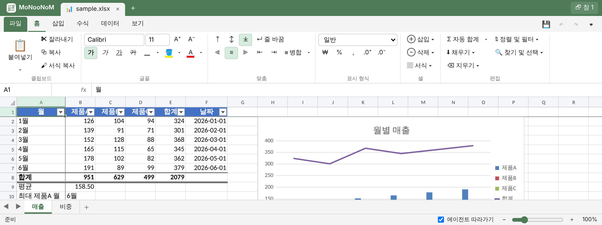

# Use

**English** | [한국어](usage.ko.md) · [Back to README](../../README.md)

## Working with the agent



Ask the agent as usual: "Open report.xlsx so we can look at it together", "Add a monthly total column and make a line
chart", "Check the cell I just changed and fix the other rows the same way".

- The agent starts the server and gives you the preview URL (`http://127.0.0.1:8765/#t=<token>`). Open it exactly as given; the `#t=` token is the key.
- Claude Code desktop opens it in its preview pane; in VS Code or Cursor use Simple Browser; elsewhere any browser.
- Edits from the agent and from you are merged in order and appear in every open window. Cells the agent changes are highlighted, and the status bar says what it did.
- **Follow agent** (status bar): on, the view moves to where the agent works; off, the view stays and the agent's changes are only highlighted.
- Saving keeps the previous file in `<workspace>/.monoonom/backups/`. Files changed by another program since they were opened are not overwritten without asking.

## Undo and change history

- **Ctrl+Z / Ctrl+Y** undo and redo your own changes in that window (up to 300 steps).
- **View > Change History** (or click "● Agent working" in the status bar) lists every change since the workbook
  was opened, newest first: who made it (Agent, You, Another window), what and where (click a range to go
  there). **Undo** on any change takes it back in every window, including the agent's changes; it is recorded
  as a new change. If the same cells were changed again afterwards, it asks first. The agent sees your undo the
  next time it edits.
- Every save first copies the previous file to `.monoonom/backups/NAME.YYYYMMDD-HHMMSS.xlsx`.

## Pictures

Paste a picture into the preview (a screenshot, or an image copied from a web page): it is placed at the
active cell, at most 640 px wide. Drag it to move it, drag a corner to resize it (Shift keeps its shape),
press Delete to remove it; the right-click menu resets its size or changes its order. Pictures in the file
are shown too, and all of them are saved as real Excel pictures. When the clipboard holds cells copied
from Excel (which also carry a picture of them), they paste as cells. The agent adds pictures from files
with `xl.py image add`.

## Language

The preview is in English, or in Korean when the browser's language is Korean. Add `?lang=en` or `?lang=ko` to the
URL to choose (the browser remembers it). New workbooks and pivot tables made from the Korean preview get Korean
Excel's names and labels (통합 문서1, 총합계); the agent does the same with `--lang ko`.

## Commands

The agent drives the workbook with `xl.py`; you can run the same commands from the workspace folder:

```bash
XL=<skill folder>/scripts/xl.py
python3 $XL serve                       # start the server (or reuse one) → preview URL
python3 $XL open report.xlsx            # open → shows up as a tab in the preview
python3 $XL describe                    # sheets, used ranges, headers, charts, pivots
python3 $XL fill 'G2:G7' '=E2*0.3'      # fill a formula (relative references shift)
python3 $XL chart add A1:D7 --type line --title Trend --at H20
python3 $XL changes --since 0 --actor user   # what you changed in the preview
python3 $XL save                        # save
python3 $XL stop
```

All commands: [`references/cli.md`](../../.agents/skills/monoonom/references/cli.md) · batch edits:
[`references/edits.md`](../../.agents/skills/monoonom/references/edits.md) · problems:
[`references/troubleshooting.md`](../../.agents/skills/monoonom/references/troubleshooting.md)

## Keyboard shortcuts

Most Excel shortcuts work: `Ctrl+N/O/S`, `F12`, `Ctrl+Z/Y`, `Ctrl+C/X/V`, `Ctrl+Alt+V`, `Ctrl+B/I/U/5`, `Ctrl+1`, `F2`,
`F4`, `Alt+Enter`, `Ctrl+Enter`, `Ctrl+D/R`, `Ctrl+;`, `Alt+=`, `Ctrl+Shift+L`, `Alt+↓`, `Ctrl+F/H`, `Ctrl+arrows`,
`Ctrl+Shift+arrows`, `Ctrl+Home/End`, `Ctrl+Space`, `Shift+Space`, `Ctrl++/-`, `Ctrl+PgUp/PgDn`, `Shift+F11`, `Alt+F1`,
`Shift+F2`, `Ctrl+K`, `F9` and more. The full list is behind the `⌨` button in the app.
In a regular browser tab the browser may take `Ctrl+N/W/Tab` first (use `Alt+N` or click the tab instead).
